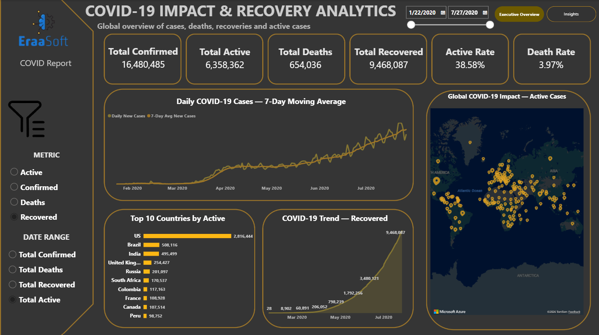
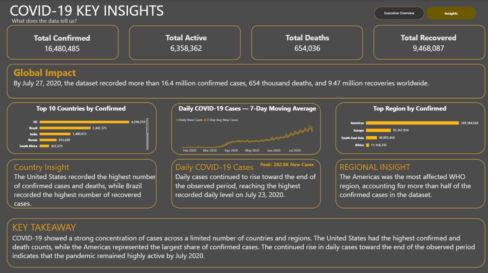

# 🌍 COVID-19 Impact & Recovery Analytics

An end-to-end data analytics project exploring the global impact, spread, and recovery patterns of COVID-19 across countries and WHO regions.

The project combines **Python, Pandas, Power BI, and DAX** to transform raw COVID-19 data into validated analysis, interactive dashboards, and actionable insights.

---

## 🎯 Project Overview

The goal of this project was not only to report COVID-19 numbers, but to understand:

- How large was the global impact?
- How severe was it?
- How many people recovered?
- Where was the impact concentrated?
- Which countries were above the global average?
- How did the situation evolve over time?

**Main Question:**

> How did COVID-19 spread, impact populations, and evolve across countries and regions over time?

---

## 🗂️ Dataset

The analysis uses COVID-19 data covering:

- **187 countries**
- **188 days**
- **January 22, 2020 → July 27, 2020**
- **35,156 daily records**
- **10 analytical variables**

Main fields include:

- Date
- Country / Region
- Confirmed
- Deaths
- Recovered
- Active
- New cases
- New deaths
- New recovered
- WHO Region

---

## 🧹 Data Cleaning & Validation

The raw data was audited and validated before analysis.

### Data quality checks

- Missing values checked
- Duplicate records checked
- Data types validated
- Country/date structure validated
- Active cases independently recalculated
- Outliers identified using the IQR method

The final `full_grouped` dataset contained:

- **0 missing values**
- **0 duplicate records**

### Active Cases Validation

Instead of relying blindly on the provided Active column, it was independently calculated as:

```text
Active = Confirmed − Deaths − Recovered
```

This helped ensure consistency between the main COVID-19 measures.

---

## 📊 Statistical Analysis

The project analyzed four main cumulative indicators:

| Metric | Total | Average per Country | Maximum |
|---|---:|---:|---:|
| Confirmed | 16.48M | 88.13K | 4.29M |
| Deaths | 654K | 3.50K | 148K |
| Recovered | 9.47M | 50.63K | 1.85M |
| Active | 6.36M | 34.00K | 2.82M |

The analysis also identified countries above the overall average:

| Metric | Countries Above Average |
|---|---:|
| Active | 24 |
| Confirmed | 25 |
| Deaths | 26 |
| Recovered | 28 |

---

## 🔎 Key Findings

### 1. Impact was highly concentrated

The top 10 countries accounted for approximately **68% of all confirmed cases**.

### 2. The Americas carried the largest regional burden

The Americas represented approximately **53.6% of confirmed cases** in the dataset.

### 3. The pandemic was still accelerating

The highest number of daily new cases occurred on:

**July 23, 2020 — 282,756 new cases**

The same date recorded the highest daily deaths:

**9,966 deaths**

### 4. A minority of countries drove the global numbers

Only **24–28 countries**, depending on the metric, were above the global average.

This shows that the global totals were strongly influenced by a relatively small group of countries.

---

## 🐍 Python Analysis

Python and Pandas were used for:

- Data loading
- Data auditing
- Missing-value checks
- Duplicate detection
- Data validation
- Data cleaning
- Outlier detection
- Statistical analysis
- Above-average country analysis
- Exporting cleaned datasets

Main script:

[`COVID19_Cleaning_Analysis.py`](python/COVID19_Cleaning_Analysis.ipynb)

---

## 📈 Power BI Dashboard

The final analysis was transformed into an interactive Power BI dashboard.

### Executive Overview

The dashboard includes:

- Dynamic KPI cards
- Date slicer
- COVID metric selector
- Daily trend analysis
- Cumulative trends
- Top 10 countries
- Global map
- Interactive filtering

### Insights Page

The second page focuses on decision-oriented insights:

- Global impact
- Top affected countries
- Regional distribution
- Daily case trends
- Key analytical takeaways

---

## 🖼️ Dashboard Preview

### Executive Overview



### Insights Dashboard



---

## 💡 Insights & Recommendations

Based on the analysis, the project recommends:

### 1. Focus resources

Prioritize countries and regions with the highest disease burden.

### 2. Monitor daily trends

Use daily cases together with a 7-day moving average to distinguish real trends from daily fluctuations.

### 3. Separate cumulative and daily metrics

Cumulative values show overall impact, while daily values show the current direction of the outbreak.

### 4. Automate the analytical pipeline

The Python cleaning and validation process can be connected to Power BI refresh workflows for future datasets.

---

## 🛠️ Tools & Technologies

| Tool | Purpose |
|---|---|
| Python | Data cleaning & analysis |
| Pandas | Data manipulation |
| Power BI | Interactive visualization |
| DAX | Measures & calculations |
| Excel | Source data & validation |
| GitHub | Version control & project documentation |

---

## 📁 Project Structure

```text
COVID-19-Impact-and-Recovery-Analytics/
│
├── data/
│   ├── COVID_final_data.csv
│   ├── COVID_statistics.csv
│   ├── Active_Above_Average.csv
│   ├── Confirmed_Above_Average.csv
│   ├── Deaths_Above_Average.csv
│   └── Recovered_Above_Average.csv
│
├── python/
│   └── COVID19_Cleaning_Analysis.py
│
├── powerbi/
│   └── COVID19_Dashboard.pbix
│
├── report/
│   └── COVID19_Analysis_Report.docx
│
├── presentation/
│   └── COVID-19 Impact & Recovery Analytics.pptx
│
├── screenshots/
│   ├── executive_overview.png
│   ├── insights_dashboard.png
│   └── presentation_preview.png
│
└── requirements/
    └── COVID19_Data_Analysis_Report_Requirements.pdf
```

---

## 📚 Documentation

- [Project Report](report/COVID19_Analysis_Report.docx)
- [Project Presentation](presentation/COVID-19-Impact-&-Recovery-Analytics.pptx)
- [Python Analysis](python/COVID19_Cleaning_Analysis.ipynb)
- [Power BI Dashboard](powerbi/COVID_BI.pbix)
- [Project Requirements](requirements/COVID19_Data_Analysis_Report_Requirements.pdf)

---

## 🎥 Project Presentation

A complete video walkthrough of the project was also recorded, covering:

**Raw Data → Cleaning → Analysis → Insights → Power BI Dashboard → Recommendations**

---

## 📌 Project Status

**Completed ✅**

This project was developed as a practical data analytics portfolio project, combining data cleaning, statistical analysis, visualization, business thinking, and dashboard development.

---

## 👤 Author

**Ali Amr Ahmed Shoman**

Chemistry Student | Aspiring Data Analyst

**Skills:** Python • Pandas • Power BI • DAX • Excel • SQL • Data Visualization# 🌍 COVID-19 Impact & Recovery Analytics
